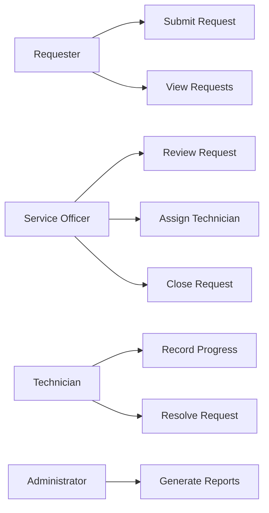
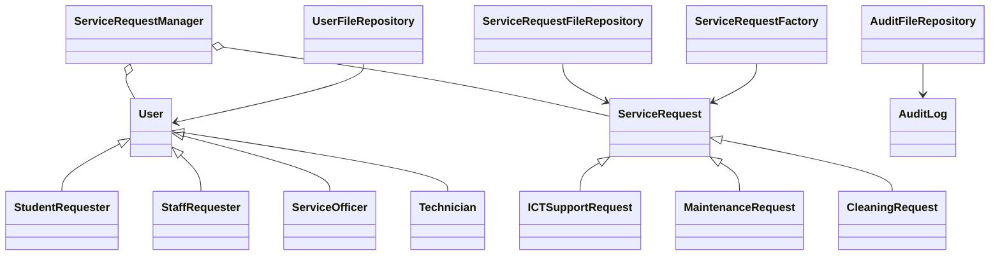
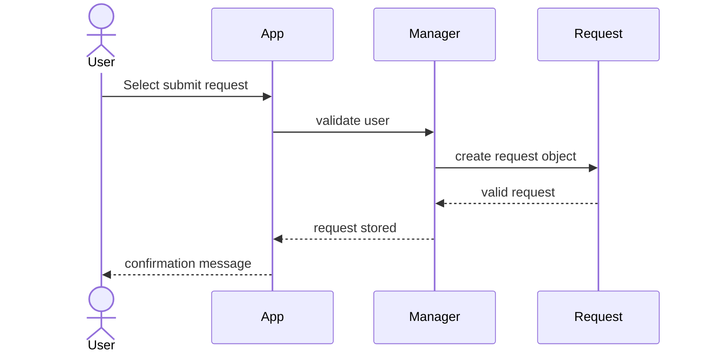
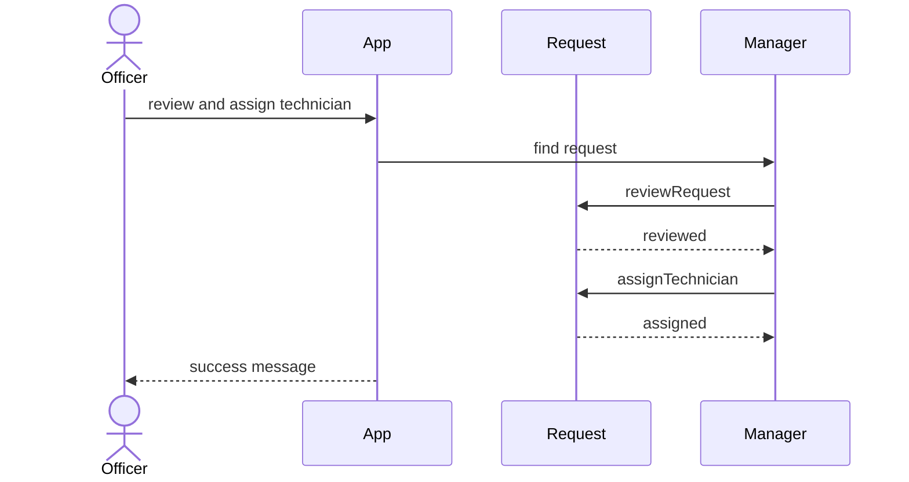
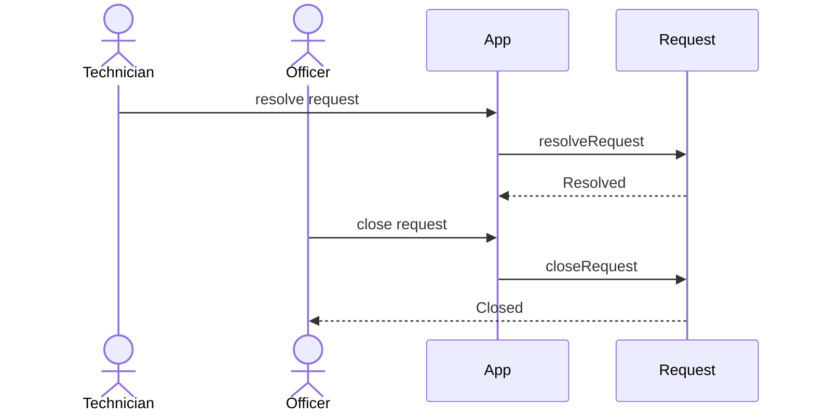

# UML and System Design

## Use Case Diagram

## Class Diagram

## Sequence Diagram: Submit Request

## Sequence Diagram: Assign Technician

## Sequence Diagram: Resolve and Close

## Class Relationship Explanation
The application uses inheritance to represent specialised user and request types. `User` is the base class and each role extends it. `ServiceRequest` is the abstract-style base class for request categories. The manager class coordinates all objects and the repositories handle persistence to JSON.
